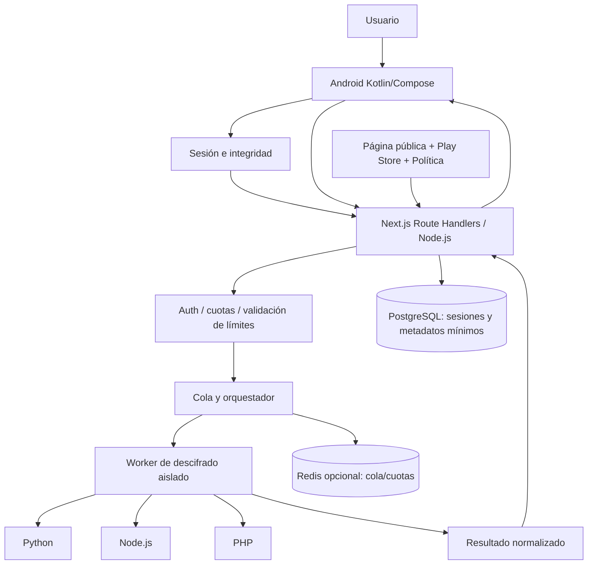

# SP-DECODE Cloud — Informe técnico y plan de migración

**Fecha:** 16 de octubre de 2026  
**Repositorio:** `Gh0stDeveloper/SP-DECODE` (privado)  
**Rama inspeccionada:** `main`  
**Estado del documento:** propuesta técnica; no se ha modificado ni desplegado código  
**Objetivo:** convertir Android en cliente online y centralizar todos los descifrados en infraestructura propia, preservando la interfaz.

## 1. Resumen ejecutivo

La estrategia recomendada es separar SP-DECODE en tres productos operativos:

1. **SP-DECODE Android:** aplicación Kotlin/Jetpack Compose, sin motores de descifrado distribuidos, encargada de importar datos con SAF, pedir autorización, comunicarse con la API y mostrar/guardar los resultados.
2. **SP-DECODE Cloud API:** Next.js App Router ejecutado sobre Node.js, con autenticación, contratos de entrada y salida, gestión de trabajos, panel de operaciones, políticas y métricas desprovistas de contenido sensible.
3. **SP-DECODE Decoder Workers:** servicios aislados que reutilizan los motores originales Python, JavaScript/Node.js y PHP, sin acceso público directo, con límites de CPU, memoria, entrada y tiempo, y sin salida a Internet por defecto.

El motor de descifrado debe migrarse **sin reescritura indiscriminada**. El punto de partida será el catálogo canónico de `spdecode/registry.py` y los decodificadores originales. La aplicación debe perder la capacidad de descifrar offline, pero conservar sus mecanismos locales de presentación, importación, exportación, preferencias e historial cifrado.

**Decisión de infraestructura:** alojar motores y coordinador de trabajos en VPS propio mediante contenedores. Next.js se puede alojar en el mismo VPS o, para la web de promoción, en Vercel, con API y workers separados. No utilizar una única función serverless como ejecutor de todos los scripts y archivos.

## 2. Base comprobada en el repositorio

### 2.1 Archivos y capas existentes

| Ruta | Propósito actual | Destino propuesto |
|---|---|---|
| `android/app/src/main/java/com/ghostdeveloper/spdecode/MainActivity.kt` | Importación, flujo de archivos/texto y llamada a motor local | Introducir cliente cloud y conservar presentación/estado |
| `android/app/src/main/java/com/ghostdeveloper/spdecode/parity/AndroidOfflineDecoderRouter.kt` | Selección y ejecución de motor Android | Sacar de artefacto de producción Cloud; conservar temporalmente solo para paridad/tests en rama aislada |
| `android/app/src/main/java/com/ghostdeveloper/spdecode/TextProtocolDecoder.kt` | Identificación y descifrado local de texto | Conservar identificación superficial UX si se requiere; ejecutar algoritmos en servidor |
| `android/app/src/main/java/com/ghostdeveloper/spdecode/HttpInjectorCloudPort.kt` | Importación online especial de HTTP Injector | Trasladar su operación remota al backend y mantener en Android solo entrada de referencia |
| `android/app/src/main/java/com/ghostdeveloper/spdecode/NurTunnelServerCatalog.kt` | Obtención remota y decodificación local de catálogo | Servidor realiza descarga autorizada/validación/descifrado y devuelve resultado |
| `android/app/src/main/java/com/ghostdeveloper/spdecode/parity/AndroidDecoderCatalog.kt` | Inventario y detección de formatos | Reemplazar catálogo estático con metadatos públicos, versionados y compatibles con backend |
| `android/app/src/main/java/com/ghostdeveloper/spdecode/parity/SecureAssetVault.kt` | Recursos de motor empaquetados protegidos | Dejar de empaquetar materiales de motores en la aplicación Cloud |
| `spdecode/registry.py` | Registro de decodificadores Python/Node/PHP | Fuente canónica para registro del worker cloud |
| `spdecode/executor.py` | Ejecución CLI de scripts registrados | Reutilizar patrón de argv sin shell, endurecido en un worker aislado |
| `spdecode/handlers/text_protocols.py` | Protocolos de texto en el bot | Extraer funciones independientes del bot y exponerlas a worker |
| `decoders/Python/`, `decoders/JavaScript/`, `decoders/PHP/` | Motores originales | Mantener privados en contenedor de ejecución |
| `.github/workflows/android-signed-release.yml` | APK firmado | Ampliar pipeline para AAB Google Play y compatibilidad de firma |
| `.github/workflows/validate.yml` | Validación y paridad | Ampliar a pruebas de API, contrato, despliegue, seguridad y regresión |

### 2.2 Alcance del catálogo

`AndroidDecoderCatalog.kt` define **239 sufijos auditados**: 61 legacy, 81 genéricos, 41 Ultra, 16 Renz, 27 especiales y 13 independientes. Detecta además `.solid` en una ruta específica. El catálogo señala `androidCertifiedSuffixes = 0`: la implementación de un port no equivale a compatibilidad verificada con todas las versiones exportadoras. La oferta pública debe nombrar formatos concretamente verificados.

### 2.3 Baseline Android revisado

`android/app/build.gradle.kts` contiene `applicationId=com.ghostdeveloper.spdecode`, `versionName=1.1.4`, `versionCode=25`, `minSdk=24` y `targetSdk=35`; usa Kotlin/Compose, ofuscación R8 y shrink de recursos en release. `AndroidManifest.xml` ya concede `INTERNET` por una integración específica, deshabilita tráfico HTTP claro y backups de aplicación. Estos datos son una instantánea del código revisado, no una afirmación de que esa misma versión ya esté disponible en Play.

**Bloqueante de distribución:** desde el 31 de agosto de 2026 Google Play exige API de destino 36 para nuevas apps y actualizaciones ordinarias de móvil, salvo excepciones o extensión aplicable. Elevar el target y ejecutar pruebas de compatibilidad antes de enviar un AAB.

## 3. Principios de diseño

1. **Una sola API de producto.** El usuario nunca llama directamente a los contenedores con decodificadores ni ve rutas de scripts/llaves.
2. **Paridad y compatibilidad.** Para cada formato/version, comparar JSON/texto crudo, errores, mensajes de variantes, flags, subcampos, orden y metadatos con baseline verificado.
3. **Cero secretos universales en APK.** C++/JNI, R8 y vault sirven de protección auxiliar, no de frontera de confidencialidad.
4. **Privacidad predeterminada.** No guardar archivos subidos ni resultados descifrados en la base de datos; retenerlos solo el tiempo indispensable en memoria/directorio temporal y eliminarlos tras finalizar o vencer un TTL corto y configurable. No introducir contenido en logs.
5. **Sin ejecución arbitraria.** Seleccionar únicamente motores preaprobados de un registro interno; nunca aceptar rutas de scripts, comandos o rutas locales desde la API.
6. **Backend independiente del bot.** El bot puede reutilizar librerías de decodificación, pero la API no debe depender de Telegram, tokens de bot ni polling.
7. **Errores estructurados.** Una variante no soportada debe indicarse como tal; no marcar éxito simplemente porque un proceso escribió stdout.
8. **No falsos reclamos.** Informar que los archivos/configuraciones se transmiten para tratamiento remoto y solicitar el consentimiento adecuado.

## 4. Diagrama lógico



### 4.1 Alojamiento

**Opción preferida — VPS propio:** Nginx como proxy TLS, Next.js en proceso Node, orquestador y workers en Docker Compose (o sistema equivalente), PostgreSQL protegido, Redis solo cuando haya una necesidad real de cola/concurrencia. Datos temporales en volúmenes efímeros aislados; evitar vincular el socket de Docker o directorios de credenciales a contenedores que procesan archivos.

**Opción híbrida:** landing Next.js en Vercel; `api` y workers en VPS. La landing usa la API solo para metadatos públicos/estado. Si toda la API se despliega en Vercel hay límites de 4.5 MB en cuerpos de requests/responses de funciones; para cargas grandes se necesitan flujos directos a almacenamiento privado o una API de upload propia.

**DNS de ejemplo (no son dominios existentes):** `www.TU-DOMINIO`, `api.TU-DOMINIO` y un nombre interno exclusivo de workers. Solo exponer HTTPS al exterior.

## 5. API pública — Contrato v1 propuesto

Base: `https://api.TU-DOMINIO/api/v1` (marcador, no dirección desplegada).

| Método y ruta | Finalidad | Notas |
|---|---|---|
| `GET /health` | Salud mínima | Sin información de infraestructura interna |
| `GET /capabilities` | Formatos/versiones habilitados | Solo ID, nombre, límites, compatibilidad y versión; sin scripts o secretos |
| `GET /config` | Versión mínima y parámetros públicos | Config firmado o protegido contra cachés incorrectas |
| `POST /session` | Iniciar sesión anónima temporal | Verificar Play Integrity donde corresponda, aplicar cuotas y crear token de corta vida |
| `POST /decode/file` | Procesar archivo pequeño | `multipart/form-data`, file y metadata acotada, autenticación requerida |
| `POST /decode/text` | Procesar texto/protocolo | JSON con texto, esquema y decoder hint validado |
| `POST /decode/import/cloud` | Referencias de HTTP Injector Cloud | El backend resuelve la referencia de forma controlada |
| `POST /decode/import/catalog` | Catálogo especial (p. ej. NUR) | Referencia/operación preaprobada, no URL arbitraria |
| `POST /jobs` | Trabajos asíncronos/lotes grandes | Devuelve ID efímero; idempotencia sin conservar material sensible |
| `GET /jobs/{id}` | Estado de trabajo | Acceso solo a propietario del trabajo; TTL corto |
| `DELETE /jobs/{id}` | Cancelación y borrado | Terminar proceso si procede y purgar restos |

Algunos endpoints podrán agruparse internamente tras decidir el contrato final. No es necesario exponer cada algoritmo como endpoint diferente.

### Ejemplo — petición de archivo

```http
POST /api/v1/decode/file
Authorization: Bearer <session-token>
Content-Type: multipart/form-data; boundary=...
X-Request-Id: <uuid>
```

Campos multipart: `file` (bytes originales), `filename` saneado, `formatHint` opcional (nunca autoritativo), `options` (JSON acotado). Los materiales aportados por usuario como contraseña/HWID se incluirán **solo cuando sean necesarios** y exclusivamente en solicitud HTTPS; no se guardan en backend.

### Ejemplo — respuesta estable

```json
{
  "requestId": "req_example",
  "status": "success",
  "decoder": {
    "id": "http-injector",
    "format": "ehi",
    "version": "cloud-engine-example"
  },
  "result": {
    "rawText": "{\"example\":true}",
    "structured": { "example": true },
    "warnings": [],
    "partial": false
  },
  "processing": { "elapsedMs": 125 }
}
```

*Ejemplo sintético, no resultado real ni contrato ya implantado.* Evitar respuestas que reformateen o trunquen silenciosamente el JSON original. Si la salida no es JSON, `structured` puede ser `null`, preservando `rawText`.

### Estados y errores

- `success` (200), `partial` (200 con advertencias explícitas), `unsupported_format` (422), `unsupported_variant` (422), `invalid_input` (400/422), `authentication_required` (401), `forbidden` (403), `rate_limited` (429), `timeout` (504), `cancelled` (409) e `internal_error` (500).
- Agregar `safeErrorCode`, `requestId` y `retryAfter` cuando corresponda. Nunca devolver trazas internas, rutas de servidor, stderr completo, nombres de recursos secretos o credenciales.
- Las solicitudes de descifrado no deben almacenarse en cachés compartidas: usar `Cache-Control: no-store`.
- Fijar límite de entrada por formato basado en baseline Android y mediciones del worker; la UI actual aplica distintos límites, no uno universal.

## 6. Workers — Reutilización segura de motores

Implementar `DecoderService` como librería independiente de Telegram:

- `detect`: identifica por extensión compuesta más inspección de contenido cuando exista firma conocida.
- `resolve`: mapea ID de motor a ruta/runtime internos inmutables.
- `execute`: lanza proceso con argv explícito, sin `shell=True`, bajo usuario no privilegiado y contenedor aislado.
- `normalize`: valida código de salida y resultado sustantivo. Respeta bytes, Unicode, JSON incompleto y campos sensibles.
- `cleanup`: borra contenido temporal después de procesar, cancelar o expirar.

Respetar para cada motor su directorio de trabajo y dependencias legado. No cambiar algoritmo por conveniencia; primero encapsular. Fijar versiones de dependencias, limitar tamaño máximo de stdout/stderr, desactivar permisos de red por defecto, usar archivos temporales generados por backend y **no confiar en nombre/ruta proporcionados por clientes**. Ejecutar pruebas de formatos maliciosos, zip bombs, salidas gigantes, bloqueos, subprocesos huérfanos y condiciones de carrera.

Para importaciones de terceros que requieran Internet (HTTP Injector Cloud, catálogos): crear adaptadores separados con endpoints/dominios permitidos, resoluciones DNS controladas, protección SSRF, timeout, límites de redirecciones y tamaño. Informar al usuario si se consultan servicios de terceros. No admitir URLs arbitrarias suministradas desde Android.

### Fuentes de verdad

`spdecode/registry.py` y `decoders.json` se convierten en el registro de compatibilidad del backend. `decoder_catalog.json` en Android se reduce a un manifiesto **público y no confidencial** de formatos que anuncie la API (con caché local de metadatos, no de claves).

## 7. Android — Migración sin rediseño

### 7.1 Componentes nuevos

```text
android/app/src/main/java/com/ghostdeveloper/spdecode/cloud/
├── CloudApiClient.kt
├── CloudDecodeRepository.kt
├── CloudSessionManager.kt
├── CloudCapabilitiesRepository.kt
├── CloudDecodeModels.kt
├── CloudErrorMapper.kt
└── CloudConnectionState.kt

android/app/src/main/cpp/       # Opcional
├── CMakeLists.txt
├── spdecode_transport.cpp
└── spdecode_jni.cpp
```

`MainActivity` mantendrá picker, flujo de lotes, presentación de resultados, locales, diálogo de progreso e historial cifrado. Sustituirá el camino directo a `AndroidOfflineDecoderRouter.decode*` por `CloudDecodeRepository` y `TextProtocolDecoder.decode` por `/decode/text`. El flujo HC protegido requiere transportar contraseña/HWID **aportados por usuario** sin persistirlos ni transmitirlos antes de autorización. Las pantallas `SpDecodeApp` y estilos actuales se mantienen.

### 7.2 Eliminar motores distribuidos

Una app realmente 100% cloud no debe empaquetar los algoritmos, tablas, perfiles o recursos recuperables de los motores. En la compilación final, retirar `parity/*` correspondiente a motores, tablas `assets` protegidas, binarios, dependencias cripto exclusivas de motores y generadores del vault, una vez que sean sustituidos y las pruebas de paridad estén completas. Conservar código de integración de presentación e historial cifrado. Los tests de comparación offline pueden vivir fuera de la app de producción, en un módulo exclusivo de pruebas/CI.

No basta con que la UI deje de invocar los motores: si siguen incluidos en DEX/assets, terceros aún podrían extraerlos.

### 7.3 Cliente de red C++ opcional

Si se requiere transporte implementado en C++, utilizar JNI para funciones acotadas `createSession`, `decodeFile`, `decodeText`, `cancelRequest`. Kotlin administra SAF, lifecycle, Compose y estado; C++ gestiona serialización/transporte TLS y retorna un resultado limpio a Kotlin. Mantener certificados válidos y hacer comprobación adicional solo con rotación/política de recuperación. **No incrustar tokens de servidor, API keys permanentes ni claves privadas en bibliotecas nativas**: los binarios `.so` también son reversibles. Un cliente Kotlin con OkHttp bien protegido es suficiente en la mayoría de casos; C++ sería una preferencia de implementación, no garantía de seguridad.

### 7.4 Interfaz y funcionamiento offline

No modificar diseño, tabs, componentes de JSON, menús, colores, idiomas ni historial. En caso de ausencia de red, presentar `Sin conexión` y permitir consultar resultados previamente guardados, pero no procesar nuevos archivos offline. Cancelar solicitudes al salir de la operación, limpiar buffers y evitar doble envío de datos por recreación de Activity.

## 8. Seguridad y protección de algoritmos

### 8.1 Autenticación

Se recomienda una sesión anónima por instalación, sin obligar a crear cuenta inicialmente. Solicitud Play Integrity para operaciones de valor, validación del veredicto en backend, token efímero ligado a sesión y límites por instalación/IP. No basar protección solo en Play Integrity: combinar con rate limits, control de concurrencia, cuotas, detección de abuso y claves del servidor. Gestionar dispositivos de prueba, instalaciones en pruebas cerradas y fallos temporales de Google sin bloquear arbitrariamente usuarios legítimos.

La integridad se verifica en el **servidor**: validar paquete, firma Play, detalles/nonce o request hash según modalidad, frescura y condiciones de licencia donde aplique. La API propia no debe confiar en un booleano de Android `isTrusted=true`.

### 8.2 Datos de los usuarios

Muchos archivos VPN pueden contener hosts, contraseñas, tokens y cuentas. Transmitirlos para decodificarlos constituye procesamiento remoto de material sensible. Implementar:

- HTTPS moderno y `no-store`; evitar URL query para datos privados.
- No persistencia por defecto de archivos y resultados en backend; cleanup en `finally` y barrido por TTL para procesos caídos.
- No registrar payload, contraseñas, resultados, HWID ni identificadores innecesarios. Redactar errores y trazas.
- Bases de datos solo para sesiones anónimas, cuotas, estado técnico y versión de algoritmos, con TTL.
- Recursos separados para trabajadores; permisos mínimos y aislamiento de red/sistema de archivos.
- Consentimiento/descripción previa a subir archivos y política de privacidad transparente en app y sitio.
- Opción de borrar historial local; si posteriormente hay cuentas, eliminación de cuenta y datos en app y web según política de Google Play.
- Revisar licencias, marcas, autorizaciones y derecho de uso de cada decodificador y acceso a servicios de terceros; limitar el servicio a archivos que usuarios están autorizados a procesar.

### 8.3 Riesgos principales

| Riesgo | Mitigación prioritaria |
|---|---|
| Filtración de algoritmo por APK | Retirar motores, dependencias y tablas del artefacto |
| Interceptación de archivos en tránsito | TLS, no-store, políticas de red claras |
| Filtración de secretos por logs | Instrumentación que solo registre códigos y métricas agregadas |
| Ejecución remota desde archivos hostiles | Sandbox, sin shell ni rutas arbitrarias, límites de recursos y red |
| Abuso de API | Cuotas, Play Integrity, tokens efímeros, rate limits, métricas |
| Resultados truncados o incorrectos | Corpus de fixtures, paridad con originales, validación de salidas |
| Caída del servidor | Health, alertas, despliegues graduales, restauración/rollback |
| Riesgo de proveedores externos | Allowlists, SSRF controls, políticas y consentimiento |
| Bloqueo de usuarios legítimos por Integrity | Implementación por fases, telemetría y políticas de degradación segura |

## 9. Página web oficial de promoción

Crear una landing Next.js optimizada para móviles y escritorio, independiente de la pantalla Android, con:

- **Inicio:** presentación de SP-DECODE, funcionalidades reales verificadas, capturas, botón principal `Disponible en Google Play` cuando la ficha esté publicada.
- **Funciones:** archivos y protocolos soportados, ejemplos sintéticos de resultados, importación y exportación, idiomas, historial privado.
- **Descarga:** enlace oficial de ficha Play (solo una vez conocido y publicado), enlaces de prueba cerrada exclusivamente para verificadores autorizados durante esa etapa; no prometer acceso público prematuramente.
- **Privacidad:** explicar tratamiento remoto de configuraciones, períodos de retención, contacto, solicitud de eliminación de datos y transferencia eventual a terceros.
- **Ayuda/FAQ:** conexión obligatoria, errores y formatos, requisitos de tamaño y diferencias entre cifrar/descifrar.
- **Novedades:** notas de versión tomadas de changelog público, sin claves ni detalles internos.
- **Estado:** disponibilidad del servicio a partir de checks internos agregados, sin exhibir infraestructura sensible.
- **Admin (protegido):** sesiones agregadas, errores por motor/version y gestión de formatos habilitados, sin resultados descifrados.

Se recomienda soporte ES/EN inicial, SEO (metadata OG, sitemap, robots), favicon propio, accesibilidad y soporte mobile-first. Evitar uso no autorizado de logotipos y marcas de terceros.

Estructura inicial sugerida:

```text
cloud/
├── apps/
│   └── web/
│       ├── app/
│       │   ├── page.tsx
│       │   ├── download/page.tsx
│       │   ├── features/page.tsx
│       │   ├── support/page.tsx
│       │   ├── privacy/page.tsx
│       │   ├── terms/page.tsx
│       │   ├── changelog/page.tsx
│       │   ├── admin/page.tsx
│       │   └── api/v1/.../route.ts
│       └── src/{components,lib,styles}/
│   └── decoder-worker/
│       ├── src/{registry,runner,normalize,sandbox}/
│       └── adapters/{python,node,php}/
├── packages/{contracts,shared}/
├── infra/{docker,nginx,observability}/
└── docs/{api,privacy,operations,security}/
```

El directorio `cloud/` se incorpora a SP-DECODE o se mantiene en repositorio privado separado; mantener los motores en repositorio privado y no incluirlos en el despliegue de landing si esta es pública.

## 10. Publicación Google Play

1. Crear la ficha y configurar categoría, nombre, descripción, capturas y contacto. Publicar la landing/política antes del envío.
2. Actualizar `targetSdk` de 35 a 36 o superior y probar cambios Android 16. No asumir que basta con reemplazar un número sin QA.
3. Compilar y firmar un **Android App Bundle (.aab)** para Play; conservar pipeline de APK firmado para pruebas externas solo si es necesario.
4. Verificar `applicationId=com.ghostdeveloper.spdecode`, incremento de `versionCode` y compatibilidad de actualización.
5. Configurar Play App Signing. **Revisar `ReleaseIntegrity` y sus fingerprints**: la firma Play puede diferir de la actual de GitHub Releases y producir falsos bloqueos. Usar certificados correctos para cada canal.
6. Completar Data Safety sobre archivos subidos, contenidos descifrados, identificadores, posibles terceros y retención. Publicar política coherente dentro de la app y en la web.
7. Si la cuenta es personal nueva (creada después del 13/11/2023): prueba cerrada con al menos **12 verificadores durante 14 días continuos** y solicitud de acceso a producción. Distribuir APK fuera de ese circuito no sustituye la inscripción continua en Play.
8. Lanzar rollout controlado, observar tasa de éxito por motor y errores HTTP, habilitar rollback del backend.
9. Evitar anuncios o SDK de analítica que transmitan configuraciones o credenciales. La decisión de monetización tiene implicaciones adicionales de privacidad/Play.

No cambiar el nombre de paquete ni la firma sin una estrategia expresa de continuidad. El backend puede evolucionar independientemente de APK cuando el contrato de API conserve compatibilidad.

## 11. Fases de ejecución y criterios de salida

| Fase | Actividades | Criterio de salida |
|---|---|---|
| C0 — Congelación y auditoría | Inventario de 239+`.solid`, golden fixtures, baseline de resultados/errores, activos secretos, límites y formatos verificados | Matriz de compatibilidad trazable |
| C1 — Arquitectura/contratos | Estructura `cloud/`, tipos, esquema de API v1, estado de trabajos, errores, contratos Android | Contratos revisados, casos testables |
| C2 — Motor cloud | Adaptar registro Python/JS/PHP a worker sin Telegram; sandbox y temporales | Tests locales pasan en contenedores |
| C3 — API Next.js | Sesión, upload, texto, catálogo, gestión de trabajos, quotas, audit sin payload | Integración CI + contrato y seguridad |
| C4 — Migración Android | Sustituir archivos, texto, credenciales HC, cloud imports y catálogos por llamadas remotas | Paridad funcional, UI sin rediseño |
| C5 — Reducción APK | Excluir motores y assets de producción, auditar DEX/assets/AAB | No aparecen algoritmos/materiales privados en artefacto |
| C6 — Landing y operaciones | Web, privacidad, soporte, descarga, Nginx/TLS, métricas, rollback | Web publicada y runbooks validados |
| C7 — QA y pruebas Google Play | Tests reales, carga, daños, permisos, API 36, AAB, firma, pruebas cerradas | Reporte sin bloqueantes; publicación autorizada |
| C8 — Producción y operación | Despliegue gradual, control de versiones de API, alarmas y rotación | Estabilidad y trazabilidad en producción |

**Ramas sugeridas:** `feat/spdecode-cloud-c0-audit`, `feat/spdecode-cloud-c1-contract`, etc.; PR de integración separado de `main`. No tocar `main` sin revisión y pruebas. Deben existir workflow de CI para API/worker, Docker y Android, además de escaneo de secretos y prueba de presencia/ausencia de assets en el AAB.

### QA mínimo requerido

- Paridad por **familia, versión y variante**, incluidos `.ehi` JSON completo, `.hc` protegido (contraseña/HWID/doble bloqueo), `.npvs`, `.tls`, `.solid`, texto Dark Tunnel/base64 y links/imports online.
- Validar éxito/partial/error contra goldens sin normalizar en exceso: preservar orden, campos desconocidos, valores crudos y tipos de datos.
- Verificar lotes, cancelación, duplicados, pérdida de red, reintentos seguros, tiempo de espera y dos decodificaciones simultáneas.
- Probar API maliciosa: archivos gigantes, extensiones falsas, nombres extraños, salidas grandes, path traversal, URLs locales/metadatos, agotamiento CPU y procesos huérfanos.
- Comprobar que APK/AAB no contienen tablas o algoritmos residentes.
- Validar firma de Play App Signing en dispositivo distribuido por track de Google Play, no solo APK de CI.
- Plan de rollback: backend compatible N-1 y versionado de contrato.

## 12. Prioridades y decisiones recomendadas

**Primera implementación:** contrato y runner en VPS, reutilizando motores Python existentes sin reescribir sus algoritmos; API Node/Next.js para archivos y texto; Android como cliente con la UI actual. **Después** migrar los flujos especiales, sacar materiales de motor del APK y abrir el sitio de promoción.

**Evitar inicialmente:** cuenta obligatoria, suscripciones, panel con acceso a resultados sensibles, almacenamiento permanente de archivos, caché de descifrados y microservicios excesivos. Añadir solo cuando exista una necesidad comprobada.

**Decisiones que pueden ajustarse al desplegar:** dominio oficial, proveedor del VPS, cuotas por usuario, autorización Play-only o también canal APK, política precisa de retención y versión mínima Android. No son bloqueantes para comenzar documentación/contratos.

## 13. Fuentes y documentación consultadas

**Repositorio privado:**
- https://github.com/Gh0stDeveloper/SP-DECODE/blob/main/ARCHITECTURE.md
- https://github.com/Gh0stDeveloper/SP-DECODE/blob/main/docs/android/ARCHITECTURE.md
- https://github.com/Gh0stDeveloper/SP-DECODE/blob/main/android/app/src/main/java/com/ghostdeveloper/spdecode/parity/AndroidOfflineDecoderRouter.kt
- https://github.com/Gh0stDeveloper/SP-DECODE/blob/main/android/app/src/main/java/com/ghostdeveloper/spdecode/parity/AndroidDecoderCatalog.kt
- https://github.com/Gh0stDeveloper/SP-DECODE/blob/main/android/app/src/main/java/com/ghostdeveloper/spdecode/MainActivity.kt
- https://github.com/Gh0stDeveloper/SP-DECODE/blob/main/spdecode/registry.py
- https://github.com/Gh0stDeveloper/SP-DECODE/blob/main/spdecode/executor.py
- https://github.com/Gh0stDeveloper/SP-DECODE/blob/main/android/app/build.gradle.kts
- https://github.com/Gh0stDeveloper/SP-DECODE/blob/main/android/app/src/main/AndroidManifest.xml

**Fuentes oficiales vigentes consultadas:**
- Next.js Route Handlers: https://nextjs.org/docs/app/getting-started/route-handlers
- Vercel Functions: https://vercel.com/docs/functions/limitations
- Play Integrity: https://developer.android.com/google/play/integrity/overview
- Google Play API de destino: https://support.google.com/googleplay/android-developer/answer/11926878?hl=es-419
- Google Play pruebas de cuentas personales: https://support.google.com/googleplay/android-developer/answer/14151465?hl=es-us
- Google Play datos/privacidad: https://support.google.com/googleplay/android-developer/answer/10144311

---

**Conclusión:** SP-DECODE Cloud es técnicamente viable con la base del repositorio actual. El esfuerzo más sensible no es crear una web, sino garantizar paridad entre los motores originales, retirar la lógica del paquete Android, aislar con seguridad los decodificadores y tratar correctamente la privacidad de configuraciones VPN que pueden incluir contraseñas y claves.